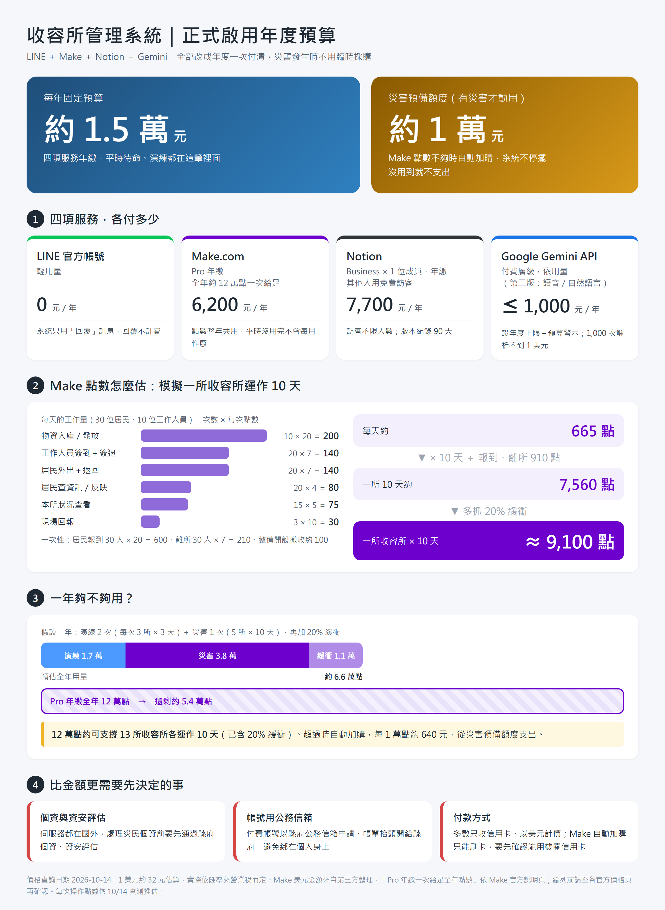

# 營運成本評估：正式啟用要付哪些費用

> 資訊圖的原始檔是 [營運成本資訊圖.html](營運成本資訊圖.html)。改數字後，用瀏覽器開啟並截圖，輸出寬度 1200px。

這份文件給社會處編列預算用。第一版演練全部使用免費方案；正式啟用時，有些服務的免費額度不夠，或免費方案的條件不適合公務使用。

**編列原則：全部改成年度預算。** 每年一次付清，平時不用每月處理帳單，發生災害時也不用臨時採購。

> **價格查詢日期：2026-10-14。** 各家價格常調整，編列預算前請到官方頁面再確認一次（連結在最後）。美元以 1 美元約新臺幣 32 元估算，實際依匯率與營業稅而定。

## 一、一句話結論

- **每年固定預算約新臺幣 1.5 萬元**：
  - Notion：只買 1 個 Business 成員，年繳。
  - Make：Pro 方案年繳，全年點數一次給足，整年都能用。
  - LINE：0 元。
  - Gemini：給一筆年度用量上限。
- **另外編一筆「災害預備額度」約新臺幣 1 萬元**：沒有災害就不動用。發生大型災害時，Make 會自動加購點數，不用臨時跑採購。
- **比金額更需要先決定的事**：雲端服務都在國外，處理災民個資之前，要先通過縣府的資安與個資評估。見第五節。

## 二、四項服務總覽

| 服務 | 在系統裡做什麼 | 演練（現在） | 正式啟用建議 | 一年約 |
|---|---|---|---|---|
| **LINE 官方帳號** | 工作人員與居民的操作介面 | 輕用量（免費） | 維持輕用量 | 0 元 |
| **Make.com** | 自動化：收到 LINE 訊息 → 讀寫 Notion → 回覆 | Free（每月 1,000 點） | **Pro 年繳**＋開啟自動加購 | 約 6,200 元 |
| **Notion** | 資料庫與社會處後台、長官儀表板 | Free | **Business 1 位成員，年繳**；其他人用訪客 | 約 7,700 元 |
| **Google Gemini API** | 第二版：自然語言或語音輸入的解析 | 免費層級（只做技術驗證） | 付費層級，設定年度用量上限 | 1,000 元以內 |

## 三、各服務說明

### 1. LINE 官方帳號

**計費方式**：每月固定費用，包含一定的「免費訊息則數」。

| 方案 | 月費（未稅）至 2026/10/31 | 2026/11/1 起 | 每月免費訊息 | 超過時 |
|---|---|---|---|---|
| 輕用量 | 0 元 | 0 元 | 200 則 | 不能加購 |
| 中用量 | 800 元 | 1,000 元 | 3,000 則 | 不能加購，要升級 |
| 高用量 | 1,200 元 | 1,400 元 | 6,000 則 | 每則約 0.2 元起 |

> 2026/11/1 的調價數字來自第三方整理。LINE 官方頁面確認有這次調整，但我們沒有查到官方的原文表格，請再確認。

**對本系統的影響：通常是 0 元。** 本系統所有回應都使用「回覆」（Reply API）。LINE 官方明確寫明，**回覆訊息、自動回應、一對一聊天都不計入訊息費用**。只有以下兩種情況會計費：

- **群發公告給所有好友**，例如「○○收容所已開設」：每則 × 好友數，很快就會超過 200 則。
- **系統主動通知**，例如核准開設後主動通知負責人：第一版刻意不做，改成負責人自己按「本所狀況」查看。

**建議**：用輕用量。如果將來要在災害時群發公告，災害當月再升級為中用量，費用從災害預備額度支出。

### 2. Make.com（自動化）

**計費方式**：LINE 每收到一則訊息，系統每做一個步驟（查 Notion、寫 Notion、回覆），就用掉 1 點（credit）。

#### 為什麼平時也要付費，不能等有災害再升級

- **免費方案撐不過一次演練**：每月只有 1,000 點，10/14 測試當天就用完了。用完時整個帳號暫停，LINE 完全沒有回應。
- **災害發生時才採購，一定來不及**：升級要用信用卡付款，還要走縣府的採購和核銷流程。系統偏偏會在災害第一天、最需要它的時候停擺。

#### 年繳選 Pro，不選 Core：點數整年共用，不會每月作廢

| 方案 | 年繳時點數怎麼給 | 適合本系統嗎 |
|---|---|---|
| Core | **每月給一次，月底沒用完就歸零**，年繳也一樣 | ✗ 平時用不到的點數每月白白作廢 |
| **Pro** | **全年點數一次給足，整年都能用** | ✓ 平時用量少、災害時一次用很多，正好適合 |

以 Pro 方案每月 1 萬點的級距為例，年繳一次拿到全年的點數（約 12 萬點），費用約 192 美元（每月約 16 美元），台幣約 6,200 元。

**向社會處說明的方式**：這筆錢是「待命費」，就像消防設備和保險。點數是全年共用的額度：平時演練用一點，有災害時集中用掉。年底沒用完，代表這一年平安。

#### 用量估算：模擬一所收容所運作 10 天

假設 30 位居民、10 位工作人員。每次操作的點數依 10/14 實測推估。

| 每天的事件 | 每天次數 | 每次點數 | 每天點數 |
|---|---|---|---|
| 物資入庫／發放（選單式，4 個步驟） | 10 | 20 | 200 |
| 工作人員簽到＋簽退 | 20 | 7 | 140 |
| 居民外出＋返回 | 20 | 7 | 140 |
| 居民查資訊／反映 | 20 | 4 | 80 |
| 本所狀況查看 | 15 | 5 | 75 |
| 現場回報 | 3 | 10 | 30 |
| **每天合計** | | | **665** |

一次性的事件共 910 點：居民報到 30 人 × 20 ＝ 600、離所 30 人 × 7 ＝ 210、整備開設撤收約 100。

- 一所收容所 10 天：665 × 10 ＋ 910 ＝ **7,560 點**
- 多抓 20% 緩衝：**約 9,100 點**

**一年夠不夠用**：假設一年有演練 2 次（每次 3 所 × 3 天）、災害 1 次（5 所 × 10 天）。

| 項目 | 點數 |
|---|---|
| 演練 2 次 | 約 17,400 |
| 災害 1 次（5 所 × 10 天） | 約 37,800 |
| 緩衝 20% | 約 11,000 |
| **全年合計** | **約 66,000** |
| Pro 年繳全年點數 | 約 120,000（還剩約 5.4 萬） |

**12 萬點約可支撐 13 所收容所各運作 10 天**（已含 20% 緩衝）。超過時自動加購。

#### 災害預備額度：開啟「自動加購」

- **怎麼運作**：點數快用完時，Make 自動加購 1 萬點，系統不會停。
- **費用**：加購的點數比方案內的貴 25%。以 Pro 1 萬點級距估算，每 1 萬點約 20 美元，台幣約 640 元。
- **有效期**：年繳方案加購的點數，到該年度結束前都能用。
- **上限**：加購總量最多等於方案本身的點數，以每月 1 萬點的級距來說，約 12 萬點、台幣約 7,700 元。
- **建議**：編列「災害預備額度」約 1 萬元。沒有災害就不動用；遇到大型災害就自動加購，事後依實際扣款核銷。
- **付款方式**：自動加購只能刷卡，要先確認能用機關信用卡支付。

> Make 官方說明頁寫明：Pro 和 Teams 年繳時一次配發全年點數；Core 年繳仍按月配發。上面的美元金額來自 2026 年 8～9 月的第三方整理，官方價格頁沒有直接列出金額。官方頁面寫明「NGO、NPO 可聯繫洽詢」，政府單位可以詢問是否有優惠。

### 3. Notion（資料庫與後台）

**計費方式**：依「成員」人數，每人每月計費；**訪客（Guest）免費，而且沒有人數上限**。

| 方案 | 每位成員每月 | 訪客 |
|---|---|---|
| Free | 0 | 有限制 |
| Plus | 約 10 美元 | 不限人數 |
| **Business** | **約 20 美元** | **不限人數** |
| Enterprise | 洽詢 | 不限人數 |

年繳最多可省 20%。

**建議做法：只買 1 位 Business 成員，其他人都用訪客。**

- **唯一的成員**：社會處承辦人，用縣府公務信箱開設。
  - 負責管理整個工作區。
  - Make 連 Notion 的授權也用這個帳號。
- **其他人都當訪客**：科長、長官、支援同仁。
  - 承辦人把系統的主頁面分享給訪客，依需要給「可編輯」或「只能檢視」。
  - 訪客只看得到被分享的頁面，看不到工作區其他內容，個資控管反而比較單純。
- **不需要 Notion 帳號的人**：現場工作人員和居民只用 LINE；Make 透過整合存取 Notion，不佔席次。
- **費用**：Business 1 位成員年繳，一年約 240 美元，台幣約 7,700 元。年繳一次付清，不用每年調整人數。

**選 Business 而不是 Plus 的理由**

- 版本紀錄保留 90 天（Plus 是 30 天），資料被誤改時救得回來。
- 內含 Notion AI，可以用來整理災後報告。
- 進階權限設定比較完整。

**要注意的事**

- **這個成員帳號只能一個人用**：不要多人共用登入。其他人一律用自己的帳號、以訪客身分加入。
- **承辦人調職時要辦移交**：交接清單要寫明移交步驟，避免資料綁在個人身上。

### 4. Google Gemini API（第二版：自然語言輸入）

**先釐清：系統用的是「Gemini API」，不是「Google AI Pro」訂閱。**

| | Google AI Pro（訂閱） | Gemini API（本系統用的） |
|---|---|---|
| 給誰用 | 給「人」用：在 Gemini App 裡聊天、寫文件 | 給「系統」用：Make 收到 LINE 訊息後送去解析 |
| 計費 | 每月或每年固定費用 | 依用量計費，沒有年繳方案 |
| 本系統需要嗎 | 不需要 | 需要（第二版） |

> Google AI Pro 訂閱附贈每月 10 美元的 Google Cloud 額度，理論上可以抵 Gemini API 的費用。但是開發者回報設定上有不少限制，不建議依賴這個方式。

**用量估算**：一句「到了泡麵 20 箱，每箱 6 碗」加上系統說明，大約 500 tokens。1,000 次解析約 50 萬 tokens，**花費不到 1 美元**。

**建議：用年度上限的方式編預算。**

- 編列一筆年度上限，例如新臺幣 1,000 元。
- 在 Google Cloud 設定預算警示，用量到上限前通知承辦人。
- 實際花費預估遠低於上限。

**個資**

- 第一版和演練只用免費層級，做技術驗證，而且**不送任何個資**。
- 免費層級送出的內容會被 Google 用來改善產品；正式啟用一定要改用付費層級（需要建立 Google Cloud 帳單帳戶）。

## 四、年度預算

### 固定預算（每年）

| 項目 | 方案 | 一年約 |
|---|---|---|
| LINE 官方帳號 | 輕用量 | 0 元 |
| Make.com | Pro 年繳（全年約 12 萬點） | 6,200 元 |
| Notion | Business × 1 位成員，年繳 | 7,700 元 |
| Google Gemini | 付費層級，年度上限 | 1,000 元 |
| **合計** | | **約 1.5 萬元** |

### 災害預備額度（有災害才動用）

| 項目 | 用途 | 上限約 |
|---|---|---|
| Make 自動加購 | 大型災害時點數不夠，每次自動加購 1 萬點 | 7,700 元 |
| LINE 升級 | 需要群發公告時，當月升級中用量 | 1,000～1,400 元 |
| **合計** | | **約 1 萬元** |

### 不在上面的費用（需要另外編列）

- **現場設備**：服務台用的手機或平板、號碼牌手環（可印 QR）、標籤機或印表機。
- **網頁版長官儀表板**（第二版）：需要一個能安全讀取 Notion 的小型後端，主機費用每月 0～數百元。
- **維運人力**：帳號管理、每次災害後清理資料、規則調整。建議指定承辦人，或委外維運。
- **教育訓練**：工作人員的行前教育、演練。

## 五、比金額更重要：正式啟用前要先確認的事

1. **個資與資安**：Notion、Make、Google 的伺服器都在國外。收容系統會處理災民姓名、年齡、健康狀況等個資，正式使用前應依《個人資料保護法》和縣府資安規定評估。可考慮的做法：
   - 改用縣府核可的雲端服務。
   - 簽訂企業方案，取得資料處理協議（DPA）。
   - 只在雲端存放必要欄位。
2. **帳號歸屬**：所有付費帳號應該用縣府的公務信箱申請，帳單抬頭開給縣府，避免綁在個人或廠商身上。
3. **付款方式**：這些服務多數只收信用卡，而且以美元計價。Make 的自動加購也只能刷卡。請先確認縣府的採購和核銷流程，例如能否用機關信用卡、要不要透過代理商開立發票。
4. **用量監看**：雖然有自動加購，仍建議指定專人在災害期間查看 Make 的點數，並在 Google Cloud 設定預算警示。

## 六、官方價格頁與說明

- LINE 官方帳號（台灣）：https://tw.linebiz.com/service/account-solutions/line-official-account/
- Make.com 價格：https://www.make.com/en/pricing
- Make 年繳與月繳的點數規則：https://help.make.com/monthly-and-annual-subscriptions
- Make 加購點數與自動加購：https://help.make.com/extra-credits
- Notion：https://www.notion.com/pricing
- Google Gemini API：https://ai.google.dev/gemini-api/docs/pricing
